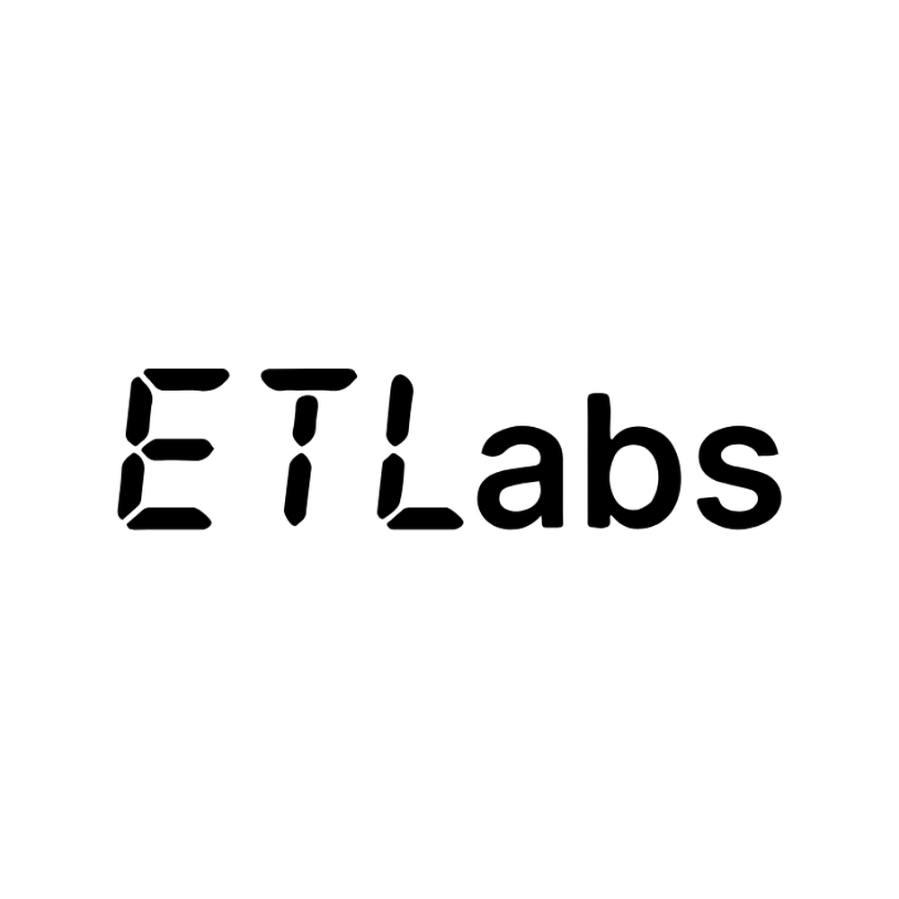

# Hi, I'm Travis Canfield

U.S. Army veteran (Signal Support Systems Specialist, 31U) and founder of **ET Labs**, an independent studio building AI-assisted apps, games and tools.

### What I build
- **[ET Labs](https://etlabs.app)**: live apps and games built with AI-assisted coding, tested before they ship
- **[Skills for Vets](https://skillsforvets.org)**: a directory of veteran training programs that installs as an app and works offline
- **[AI Detective](https://github.com/etlabsapp/ai-detective)**: ET Labs Junior project from the IBM Bob hackathon
- **[Arcane's Keep](https://github.com/etlabsapp/arcanes-keep)**: learn Python by casting it as spells (Vite + Pyodide)

### Also
- AI/LLM output evaluation for clients through Traverse Engineering
- Currently studying CompTIA Linux+ and Google Cloud Generative AI Leader

📫 [etlabs.app](https://etlabs.app)
